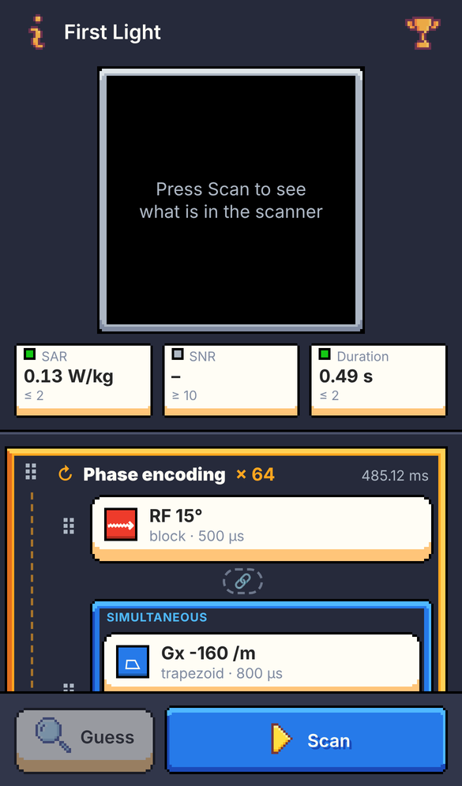
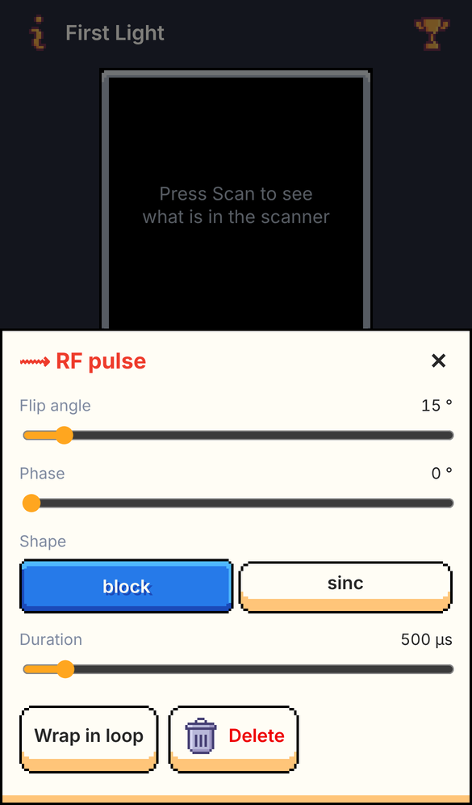

# Untitled MRI Game

A browser game for phones: build an MRI sequence from building blocks (RF pulses, ADCs,
gradients, spoilers, loops), scan a hidden phantom in a virtual scanner and figure out what is
lying in it - while staying within SAR, SNR and scan-time limits.

Simulation and reconstruction are going to run on the [MRX](docs/ARCHITECTURE.md#simulation-pipeline-mrx)
tools (Pulseq export -> `rapisim` simulation -> `trajex` trajectory -> NUFFT reconstruction).

> **Status: prototype.** Sequences are exported to Pulseq and simulated with MRX directly from
> the browser; players log in with their MRX account. Leaderboard and challenges are still
> mocks. See [docs/GAME_DESIGN.md](docs/GAME_DESIGN.md#roadmap) for what comes next.

**Play:** every push to `main` is published to GitHub Pages:
<https://j-endres.github.io/untitled-mri-game/>

> [!CAUTION]
> `VITE_MRX_API_KEY` is for local testing only: it is compiled into the JavaScript bundle and
> readable by anyone. Keep it in `.env.local`, never in CI. The Pages workflow fails if a key
> ends up in the build.

<p>
  
  
</p>

## Quick start

Requires Node.js 22 (see `.nvmrc`).

```sh
npm install
cp .env.example .env.local   # optional: test key (skips the login) or the offline mock
npm run dev        # http://localhost:5173, use your browser's device mode
npm run check      # format check, lint, typecheck, tests - run before pushing
npm run build      # static build in dist/
```

To try it on a phone in your network: `npm run dev -- --host`.

## Documentation

- [docs/GAME_DESIGN.md](docs/GAME_DESIGN.md) - how the game works, open questions, roadmap
- [docs/ARCHITECTURE.md](docs/ARCHITECTURE.md) - code structure, data model, MRX pipeline
- [CONTRIBUTING.md](CONTRIBUTING.md) - workflow, commits, code style

## Credits

UI art and icons: [Complete UI Essential Pack](https://crusenho.itch.io/complete-ui-book-styles-pack)
and Icons Essential by [Crusenho](https://crusenho.itch.io), licensed
[CC BY 4.0](https://creativecommons.org/licenses/by/4.0/). Sprites were cropped and renamed; see
[src/assets/CREDITS.md](src/assets/CREDITS.md). The credits are also shown in the game (ⓘ sheet).
